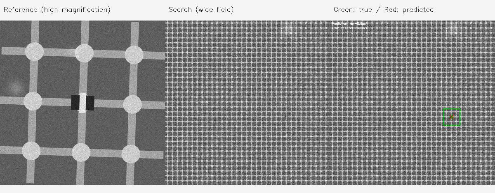

# Drift-Sense

Locate a high-magnification wafer reference image inside a wider search image and return its center `(x, y)`. Uses classical multi-scale, multi-rotation normalized cross-correlation with NumPy and OpenCV. No training, model weights or GPU is required.

Organized copy of [Tannviiii/drift-sense](https://github.com/Tannviiii/drift-sense). Original code and citations are preserved; see [attribution](docs/UPSTREAM.md).

## Quick start

Use Python 3.9+:

```bash
git clone https://github.com/Avya18/Drift-sense-Semiconconductor.git
cd Drift-sense-Semiconconductor
python3 -m venv .venv
source .venv/bin/activate
python -m pip install -r requirements.txt

python dataset_generator.py --style dram --num-pairs 1 --out dataset --seed 0
python inference.py dataset/dram_0000_ref.png dataset/dram_0000_search.png
python evaluate.py dataset
```

On Windows activate with `.venv\Scripts\activate`. Increase `--num-pairs` to 30 for a larger run, or choose `--style finfet` and a separate output directory. Generation uses a large truth canvas; start with one pair.

## Visual demo



Reproduce with `python demo.py`. The fixed DRAM seed-0 example has about **0.04 px** localization error. This is one synthetic smoke test, not a real SEM benchmark. Exact measured coordinates are in [demo-result.json](docs/demo-result.json).

## Tests

```bash
python -m unittest discover -s tests -v
```

Tests cover the complete generation/inference/evaluation workflow, FinFET generation, the CLI coordinate output, invalid arrays, incompatible dimensions, missing images and empty/malformed datasets. The [GitHub Actions workflow](.github/workflows/tests.yml) runs tests and regenerates the demo on pushes and pull requests.

## Repository layout

| Path | Purpose |
| --- | --- |
| [dataset_generator.py](dataset_generator.py) | Generate synthetic DRAM/FinFET image pairs and ground-truth CSV. |
| [inference.py](inference.py) | Localize the reference in the search image. |
| [evaluate.py](evaluate.py) | Print error, accuracy and timing; save diagnostic overlays. |
| [demo.py](demo.py) | Reproduce the visual example and measured result. |
| [tests/](tests/test_project.py) | Automated validation and end-to-end tests. |
| [requirements.txt](requirements.txt) | Minimum dependency versions for NumPy, Pillow and OpenCV. |
| [CITATIONS.md](CITATIONS.md) | Original references for imaging effects and localization. |
| [docs/](docs/README.md) | Setup, architecture, data formats, troubleshooting and upstream attribution. |

Root Python entry points remain intact so the original commands and imports continue to work. Generated datasets and outputs stay outside version control.

## Input and output

```bash
python inference.py <reference_image> <search_image>
```

The workflow targets grayscale 1000 × 1000 images with the reference pattern appearing approximately 10× smaller in the search. The final stdout line is machine-readable `x,y`, representing the match center in search-image pixels.

Evaluation reads `ground_truth.csv`, prints accuracy within 3/5/10 pixels and error/timing summaries, and writes overlays under the dataset directory. See [data format](docs/DATA.md).

## Method and limitations

The localizer searches six scales and five rotations, selects the strongest NCC response, favors near-equal peaks closest to the search center within that response map, then refines the peak to subpixel precision. Repeating arrays can still lock onto an incorrect matching cell.

The [original README](docs/UPSTREAM_README.md) reports results on 30 self-generated DRAM pairs. Those benchmark results are upstream claims, not independently reproduced by this import. Synthetic data performance does not establish accuracy on real SEM captures.

## Documentation

- [Complete setup and workflow](docs/SETUP.md)
- [Architecture](docs/ARCHITECTURE.md)
- [Data format](docs/DATA.md)
- [Troubleshooting](docs/TROUBLESHOOTING.md)
- [Upstream source and licensing](docs/UPSTREAM.md)

The upstream snapshot contains no LICENSE file. Original ownership and citations are retained.
